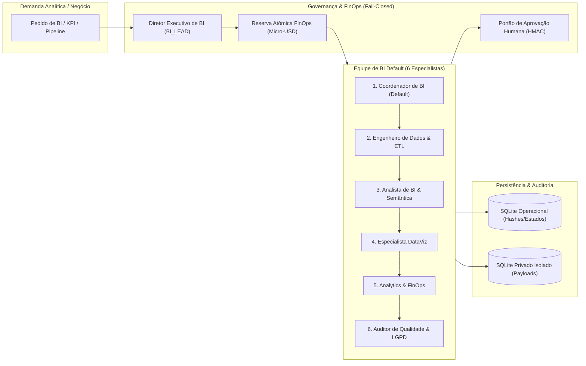

# Central-IA — Plataforma de Orquestração Multi-Agente para Business Intelligence (BI) & Analytics

[](#)
[-00875A.svg)](#equipe-de-bi-default-6-especialistas)
[-critical.svg)](#governanca-seguranca-fail-closed-e-finops)
[](#governanca-seguranca-fail-closed-e-finops)

A **Central-IA** é uma plataforma corporativa de **Orquestração Multi-Agente** projetada para eliminar o transporte manual de contexto entre ferramentas de IA, unificando **Governança Executiva**, **Controle Financeiro Atômico (FinOps)** e **Segurança Criptográfica *Fail-Closed***.

Por padrão (*Default Configuration*), a plataforma vem configurada com uma **Equipe Completa de Business Intelligence (BI) & Data Analytics** composta por **6 Agentes Especialistas** e um **Diretor Executivo de BI (`BI_LEAD`)**, operando sobre filas transacionais persistentes em SQLite com suporte multiprovedor (**Google Gemini** e **OpenAI**).

---

## Arquitetura do Sistema



---

## Equipe de BI Default (6 Especialistas)

A plataforma inicializa automaticamente a **Equipe de Business Intelligence (`DEFAULT_TEAM = 'equipe_bi'`)**, roteando demandas por intenção semântica ou executando cadeias analíticas completas (*handoff* automático de ponta a ponta):

| Identificador | Agente Especialista | Responsabilidade na Cadeia Analítica |
| :--- | :--- | :--- |
| **`coordenador_bi`** *(Default)* | **Coordenador de BI** | Estruturação de KPIs, metas estratégicas, priorização de demandas e governança analítica. |
| **`engenheiro_dados`** | **Engenheiro de Dados** | Modelagem dimensional (*Star Schema*), arquitetura *Medallion* (*Bronze/Silver/Gold*), pipelines ETL e SQL. |
| **`analista_bi`** | **Analista de BI** | Construção de cubos semânticos, medidas DAX, análise de tendência, *cohort*, *churn* e performance. |
| **`especialista_dataviz`** | **Especialista DataViz** | Arquitetura de dashboards executivos (Power BI / Looker), UX visual e *Data Storytelling*. |
| **`analytics_finops`** | **Analytics & FinOps** | Cálculo de ROI analítico, margem operacional e reserva orçamentária de nuvem e tokens de IA. |
| **`auditor_qualidade`** | **Auditor de Qualidade & LGPD** | Reconciliação estatística de dados, detecção de anomalias, linhagem e conformidade LGPD. |

---

## Governança, Segurança *Fail-Closed* e FinOps

1. **Segurança *Fail-Closed* por Padrão:**
   * Nenhuma chamada de rede ou API paga ocorre sem habilitação explícita em múltiplas camadas (`mode='live'`, flags de ambiente e orçamento positivo).
   * Isolamento físico entre o banco de auditoria operacional (`operations.sqlite3`, que armazena apenas *hashes* `SHA-256` e estados) e o banco de conteúdo (`private.sqlite3`).
   * Ações externas exigem aprovação humana vinculada criptograficamente ao *fingerprint* imutável do conteúdo (`HMAC-SHA256`).
2. **FinOps com Reserva Atômica em Micro-Dólares:**
   * Cotas diárias e por chamada são reservadas via transação `BEGIN IMMEDIATE` antes de qualquer requisição ao provedor LLM.
   * Em caso de falha ambígua ou *timeout*, a reserva é mantida para evitar estouro de orçamento por retentativas ocultas (*Circuit Breaker* persistente).
3. **Idempotência Estrita:**
   * Tarefas, fluxos e orientações do Diretor de BI possuem chaves de correlação e *fingerprints* `SHA-256`, garantindo consumo **Token-Zero** em releituras.

---

## Execução Rápida (Modo Simulado Offline — Custo Zero)

O projeto requer apenas **Python 3.11+** e executa sua suíte completa sem necessidade de chaves de API ou conexão de rede:

```powershell
# 1. Executar toda a suíte de testes unitários e de integração
python -m unittest discover -s tests -v

# 2. Acionar a Equipe de BI Default via CLI (roteamento automático por palavras-chave)
python -m central "Estruturar pipeline SQL, dashboard executivo e orçamento de KPIs"

# 3. Acionar os 6 especialistas da Equipe de BI em conjunto
python -m central "Planejar arquitetura analítica trimestral" --agents coordenador_bi engenheiro_dados analista_bi especialista_dataviz analytics_finops auditor_qualidade

# 4. Executar demonstração da cadeia supervisionada multiprovedor (OpenAI + Gemini offline)
python -m central.integrations --directory .local-reports/integrations-demo demo

# 5. Executar Motor MDM & Golden Record (Visão Única 360° + Sincronismo Holding)
python -m central.mdm demo --sync-mode coexistencia --strategy confianca_recencia
```

---

## Estrutura de Módulos

* `central/core.py` — Núcleo da Equipe de BI Default, roteador semântico e reserva orçamentária atômica.
* `central/mdm.py` — Motor **MDM & Golden Record Hub** em 5 etapas (Higienização, Deduplicação, Survivorship, Stewardship e Sincronismo 360° LGPD).
* `central/workflow.py` — Motor de cadeia analítica determinística com recuperação de falhas transitórias.
* `central/phase3/` — Fila durável supervisionada, controle de *leases*, *timeouts* de subprocesso e aprovação humana.
* `central/integrations/` — Roteamento explícito multiprovedor (Google Gemini 3.5 Flash-Lite & OpenAI) com *rate limiting* persistente.
* `central/bridge/` — Ponte de integração assíncrona com autenticação criptográfica de aprovações e isolamento de privacidade.
* `central/director/` — Diretor Executivo Cloud (`BI_LEAD`) para triagem automatizada de backlog, deduplicação e geração de painéis executivos.
* `tools/` — Verificadores de fronteira de publicação (`security_check.py`), análise estática (`run_bandit.py`) e contratos de CI (`validate_automation.py`).
