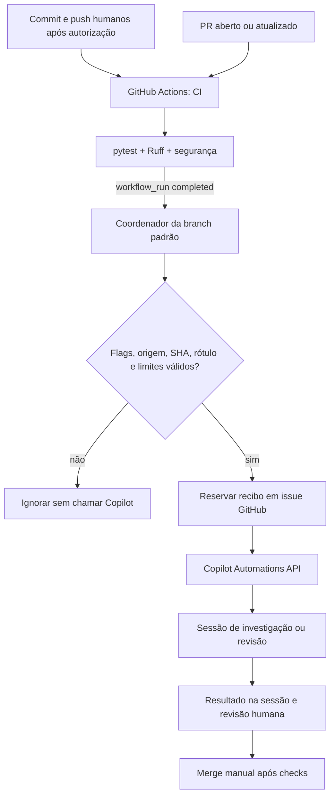

> **Decisão CEO 04/11/2026:** pesquisar solução já existente no GitHub ANTES de desenvolver; a alternativa construída do zero exige decisão fundamentada na issue Jira. [Plano](PLANO-DESENVOLVIMENTO-REUSO-GITHUB.md) · [Catálogo de 20 candidatos](CATALOGO-SOLUCOES-GITHUB.md) · [Diretor](DIRETOR-EXECUTIVO-CLOUD.md). Jira, CEP v1.0 e marcos M1–M4 preservados. Trechos antigos abaixo são registros históricos, NÃO estado operacional ou autorização live.

# Git → CI → Copilot: coordenação por eventos

Estado em 31/10/2026: implementação local, não publicada e com habilitação desligada.
Nenhum remoto, commit, push, segredo GitHub ou automação cloud foi criado nesta etapa.
Nenhuma chamada paga foi feita e a fila fase3-live não foi executada.

## Fluxo preparado

O GitHub transporta IDs, SHA, estado e links entre etapas. Não há transferência manual
de prompts ou de respostas entre chats. Os seis especialistas da aplicação continuam
funcionando no Python; o agente de desenvolvimento do Copilot é uma camada separada.

## CI sem inferência de IA

`.github/workflows/ci.yml` atende push em main e eventos pull_request opened,
synchronize, reopened e ready_for_review. Push em branch com PR usa o evento do PR,
evita duplicar CI por push+PR. Push em branch sem PR e fora de main não inicia CI.

O job depende de `CENTRAL_CI_ENABLED=true`. Enquanto ausente/falso, fica skipped.
Não configurar branch protection assumindo que um job skipped prova validação.
Só considerar o gate obrigatório após habilitar e observar uma execução completa.

Runner Linux ubuntu-24.04, Python 3.11, dez minutos de prazo, token contents:read,
checkout sem persistência de credenciais e actions fixadas por SHA. O CI instala o
lock e o pacote editable, confere dependências, valida contratos YAML/JSON, executa
Ruff, Bandit e pytest. Sem secrets de modelos e sem upload de artifacts ou logs privados.
As variáveis de API ficam em mock/false; OPENAI_API_KEY fica vazia.

As mudanças apenas documentais ainda podem rodar CI, mantendo o status obrigatório
consistente. É a etapa de IA que é filtrada para não consumir créditos nesses casos.
Execuções antigas do mesmo PR/ref são canceladas por concurrency.

Ruff usa regras essenciais de correção (E9, F63, F7, F82), sem reformatar o legado.
Não equivale à ativação de todas as regras de estilo do Ruff.
Bandit verifica central e tools. Um B310 legado em central/providers.py:45 foi
revisado: os endpoints estão fixos em HTTPS e o adaptador está bloqueado por padrão.
A aceitação está vinculada ao arquivo inteiro por SHA-256 normalizado em LF, ID e
linha; alterações exigem nova revisão. Não há exclusão global de B310. B101 é
omitido na configuração porque os asserts das ferramentas são verificações locais.
O controle de despacho/credenciais não depende de assert. Erros de scan e novos
achados bloqueiam. Isso não é auditoria completa de vulnerabilidades de dependências,
pentest, validação de prompts ou garantia de ausência de todo segredo possível.

## Ponte de coordenação

`.github/workflows/copilot-events.yml` recebe workflow_run completed do workflow CI.
Só habilita o job com CENTRAL_AI_ENABLED=true e no repositório exato
carlosfelix06/central-ia-pessoal. Nunca executa pull_request_target, nunca baixa artifacts
nem faz checkout do código do PR no contexto privilegiado. O checkout é da branch padrão.
O coordenador depende apenas da biblioteca padrão e não instala dependências do PR.

O token GitHub padrão tem contents:read, actions:read, pull-requests:read e issues:write.
A permissão de escrita serve para recibos, não para alterações de código ou merges.
O token separado COPILOT_AUTOMATION_TOKEN só precisa de Agent tasks:write no repositório
selecionado. Preferir token de usuário fine-grained com expiração curta ou um GitHub App
com o escopo documentado para automações compartilhadas, após revisão específica.
Não usar token clássico com acesso geral como atalho; não fornecer chave OpenAI ou DPAPI.

O ambiente `copilot-automation` separa o segredo da automação do CI. O nome do ambiente,
sozinho, não cria proteção: configurar e conferir revisores/escopo e disponibilidade
no plano antes do primeiro ensaio. Acesso a repositórios privados e proteções pode variar
por plano. Nenhuma proteção remota foi aplicada nesta entrega.

### Elegibilidade e autorização

O coordenador consulta novamente a execução oficial, o commit, o PR e os arquivos
alterados. Rejeita bots, forks, drafts, PR fechado, SHA antigo, workflow diferente,
rerun de CI (run_attempt diferente de 1) e atores sem permissão write/maintain/admin.
Só aceita PR com base main ou falha do push atual de main.

- Falha de PR: exige rótulo `copilot:investigate`.
- Revisão de PR após CI bem-sucedido: exige `copilot:review`.
- Rótulo `no-ai` impede ambos.
- PR apenas de documentação não consome sessão de IA.
- Alterações relevantes: central, tests, tools, .github, pyproject e lock.
- Falha de main: exige o flag de investigação; não existe rótulo de PR nesse caso.

Os rótulos devem estar presentes antes de a execução CI terminar. Adicionar rótulo
após o término não dispara uma sessão retroativamente. Um novo push humano ou uma
transição draft → ready for review pode gerar uma execução nova. Rerun de CI não
serve para contornar recibos ou limites de IA.

O contexto enviado ao agente contém apenas repositório fixo, SHA, número do PR,
ID e URL da execução e tipo de tarefa. Não inclui corpo/título do PR, saída bruta
ou comandos vindos de logs. Evidências adicionais serão lidas na sessão com ferramentas
aprovadas, tratadas como dados não confiáveis.

## Automações Copilot — modelos desativados

`config/copilot-automations/failure.json` e `review.json` são modelos para cadastro
futuro no GitHub, não workflows reconhecidos automaticamente pelo Actions.
Ambos começam enabled:false, triggers:{} e tools:[]. Não há cadastro remoto.

A ponte é a única origem de despacho. Manter os triggers nativos vazios evita executar
a mesma automação duas vezes por caminhos independentes. O código confere essa condição.
Os modelos são pessoais para o proprietário individual; uma modalidade shared exige
revisão de identidade, disponibilidade e cobrança antes do cadastro.

O catálogo `config/copilot-approved-tools.json` começa vazio. Antes de ativar,
consultar as ferramentas realmente disponíveis, selecionar somente leitura de código,
diff e checks, registrar os IDs aprovados nesse arquivo e configurar exatamente a
mesma lista na automação remota. A ponte bloqueia lista vazia e divergência remota.
Não inventamos IDs de ferramentas nem ativamos ferramentas de escrita na conta.
As instruções e a lista vazia não são uma garantia de isolamento do ambiente inteiro:
revisar também capacidades implícitas, firewall e políticas do Copilot antes de habilitar.

O resultado inicial será entregue na sessão do agente. Não há publicação automática
de comentários de revisão no PR, aprovação de PR ou correção com commit. Uma permissão
futura para comentar/alterar código exige outro escopo e outra revisão de segurança.

A API de automações está em preview. A resposta 202 com task_id confirma aceitação,
não que a sessão esteja rodando; conferir seu histórico antes de reenviar.
Autenticação de Agent tasks e formatos usados estão na
[referência oficial](https://docs.github.com/en/rest/agent-automations/agent-automations).

## Duplicação, loops e limites

Cada pedido cria uma issue de recibo antes do POST que pode consumir créditos.
Sua chave é tipo + PR/main + SHA. Até recibos dispatching ou uncertain bloqueiam
novo despacho do mesmo pedido; não há retry automático da chamada remota.
O resultado accepted ou uncertain atualiza a issue com ID de tarefa quando disponível.

O coordenador é serializado por concurrency e não cancela um despacho ativo.
Limite preparado: dois recibos por hora no repositório e dois por PR durante sua vida,
somando investigação e revisão. Tentativas incertas também contam. São limites de
quantidade, não limites de tokens, duração, créditos ou dólares.

Eventos de bot e commits de bot são ignorados para IA; o CI pode continuar validando
seus commits. Nenhuma automação é acionada por issue/comment, nenhuma agenda foi criada,
e o agente não recebe autorização para gerar commits, chamar a si mesmo ou fazer merge.

Limitações: issues são registros modificáveis por usuários autorizados; apagá-las ou
alterar o código pode invalidar limites/deduplicação. A garantia é local à ponte,
não exatamente-uma-vez do provedor. A fila de concurrency do GitHub pode substituir
runs pendentes por eventos mais recentes; não é uma fila FIFO completa. O código
prioriza SHA atual e falha fechado se a paginação passar de 2.000 issues ou 500 arquivos
alterados. Manter operação e retenção/reconciliação antes de crescimento maior.

## Custos e planos

CI não usa modelos, mas Actions em repositório privado pode consumir minutos e gerar
cobrança além da franquia. Copilot cloud agent e automações consomem AI Credits e minutos
Actions; execução não tem preço fixo garantido pelo código. A chave OpenAI não paga nem
autoriza Copilot. Controlar os dois orçamentos separadamente.

A documentação consultada informa automações em repositórios privados/internos com
planos Copilot pagos elegíveis (Pro, Pro+, Max, Business ou Enterprise) e políticas
habilitadas. Não foi verificado qual plano/quantia disponível a conta possui.
Conferir a interface de custos e configurar limites de créditos e gasto adicional
antes do primeiro ensaio; o contador de dois despachos não substitui isso.

Fonte: [automações e requisitos](https://docs.github.com/en/copilot/concepts/agent-capabilities/agent-powered-workflows-and-operations/about-automations).
[Uso do cloud agent](https://docs.github.com/en/copilot/concepts/agents/cloud-agent/about-cloud-agent).
Não usamos valores antigos de premium requests como estimativa de custo atual.

## Merges, permissões e ativação futura

O checklist local config/github-activation-checklist.json é documentação de revisão,
não um payload aplicado à API. O código não chama endpoints de merge nem concede
contents:write/pull-requests:write ao coordenador.

Após aprovação do usuário e criação/publicação do remoto privado:
1. Revisar novamente seleção de arquivos/segredos; o índice anterior ainda não inclui
   automaticamente estes novos arquivos e alterações.
2. Conferir cobrança Actions e somente então definir CENTRAL_CI_ENABLED=true.
3. Observar CI real verde em Python 3.11. Definir o check `checks` como obrigatório em
   main, restringir push direto e manter allow_auto_merge=false. Revisar recursos do plano.
   Merge será humano; escolher outro revisor quando houver exigência de aprovação.
4. Conferir plano Copilot, políticas e ambiente protegido. Cadastrar os modelos ainda
   desativados, revisar ferramentas de leitura, modelo, limites financeiros e instruções.
5. Registrar IDs nas variáveis COPILOT_FAILURE_AUTOMATION_ID e COPILOT_REVIEW_AUTOMATION_ID.
   Configurar o token somente no ambiente protegido, nunca em arquivo ou terminal compartilhado.
6. Aprovar um ensaio pequeno. Só então habilitar a automação remota correspondente,
   CENTRAL_AI_ENABLED, CENTRAL_COPILOT_TOOLS_REVIEWED e o flag específico
   CENTRAL_COPILOT_FAILURE_ENABLED ou CENTRAL_COPILOT_REVIEW_ENABLED.
7. Usar um PR fictício autorizado e acompanhar recibo → aceitação → sessão → resultado.
   Conferir créditos antes de permitir operação sem revisão a cada disparo.

Não habilitar simultaneamente a revisão automática nativa do Copilot para os mesmos
PRs: é um produto/rota independente e pode duplicar consumo. Se preferir essa rota,
desligar a revisão pela ponte e revisar filtros/limites dela separadamente.

## Como acompanhar no VS Code

Na consolidação de 31/10/2026, `code --version` informou VS Code **1.144.0**; o
relatório anterior havia registrado 1.143.1. A versão atual atende ao mínimo 1.144
documentado para gerenciamento de automações cloud, mas acesso da conta e
configuração correspondente continuam pendentes. Não atualizamos o editor nesta
consolidação, não instalamos assinaturas nem habilitamos cloud settings.
As extensões oficiais de GitHub Actions, Pull Requests e Copilot Chat ficaram recomendadas.

Após publicação e login GitHub com a mesma conta:
- Abrir Central-IA-Pessoal.code-workspace.
- Ver Actions e checks pela extensão GitHub Actions/aba do PR.
- Abrir `Chat: Open Agents window` para acompanhar sessões suportadas.
- Em versão compatível, usar Automations para histórico de execuções e custos disponíveis.
- Correlacionar SHA, ID do workflow, issue-recibo e task_id. Abrir a sessão existente,
  sem iniciar outra tarefa para o mesmo problema.

A integração é do GitHub/cliente suportado; arquivos locais não criam automaticamente
sessões na janela Agents. Sessões novas de cloud sandbox são experimentais e não são
necessariamente a mesma rota do cloud agent acionado por GitHub Actions. O histórico
no GitHub e o ID de tarefa permanecem a referência se o cliente não listar uma sessão.

Fontes: [Agents window](https://code.visualstudio.com/docs/agents/run/agents-window),
[cloud sessions](https://code.visualstudio.com/docs/agents/run/cloud-sandbox-sessions).

## Recuperação e desligamento

- Desligar CENTRAL_AI_ENABLED impede novos despachos; desligar a automação no GitHub
  e cancelar a sessão em andamento se necessário. Cancelar o workflow local não garante
  parar a sessão cloud já aceita nem estornar seu consumo.
- Se houver recibo sem tarefa conhecida, investigar histórico/API antes de qualquer
  reenvio. Não apagar o recibo como rotina de recuperação.
- 401/403/404, formato inesperado e falhas de metadados encerram a ponte sem erro bruto
  ou retry; corrigir acesso/compatibilidade primeiro. Sem recibo, rerun do coordenador
  pode reavaliar o evento original; com recibo, continuará bloqueando.
- Após falha confirmada, usar correção e novo commit humano para uma tarefa nova,
  preservando evidências e respeitando o teto de sessões.
- Recibos e rótulos não são um cofre; não incluir neles segredos ou logs privados.

## Validação local

A consolidação multiprovedor inclui o SDK oficial Gemini nas dependências de teste,
mantendo CI em modo mock, sem segredos e com os gates de integração real fechados.
As variáveis Gemini/Google estão explicitamente vazias no job. Nada disso habilita
Copilot ou acesso a modelos. Ver [INTEGRACOES-PROVEDORES.md](INTEGRACOES-PROVEDORES.md).
O verificador de publicação examina também o conteúdo efetivo do índice Git, além
dos arquivos presentes na pasta, para detectar segredos preparados anteriormente.
Mudanças em `config/`, `scripts/`, `.env.example` e `.gitignore` são relevantes para
a revisão futura, inclusive políticas de roteamento e orçamento. Alterações apenas
de documentação continuam filtradas; todos os outros gates de autorização permanecem.

`./scripts/Test-Automation.ps1` executa pip check, verificação de publicação,
contratos YAML/JSON, Ruff, Bandit e pytest. Não chama o coordenador real, Copilot,
OpenAI ou fase3-live. O coordenador foi exercitado com APIs falsas, inclusive falhas,
respostas incertas, duplicação, filtros, limites e mudança de ferramentas.

actionlint 1.7.12 foi baixado do release oficial e teve checksum SHA-256 conferido.
Foi executado localmente com `-shellcheck=`; portanto valida YAML/expressões/actions,
mas não inclui análise ShellCheck. Binário, logs e relatórios permanecem ignorados.

Os 67 testes existentes foram mantidos. A única alteração no teste legado foi ampliar
para dez segundos o timeout do fixture mock de test_phase3.py; os testes explícitos de
timeout mantêm 0,4 segundo e os limites do runtime não mudaram. Essa alteração responde
à falha observada de inicialização do processo simulado sob carga no Windows.

Consulte `.local-reports/validation-event-automation.txt` para o resultado efetivo mais
recente. Nada nesta validação comprova disponibilidade da API/planos da conta, proteção
remota de branches, cobrança exata, execução Linux real no Actions ou integração remota
com a janela Agents. Esses são ensaios pendentes após autorização.
